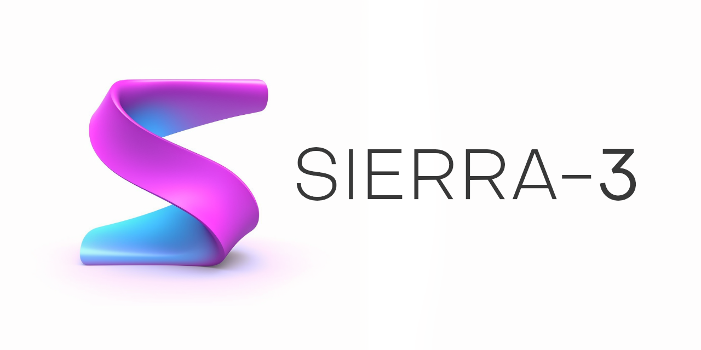

# Sierra-3
#### *Enterprise-grade API template for large-scale applications*

## Overview

This is a template for building enterprise-grade RESTful APIs with the latest PHP capabilities, built on top of Symfony.

The project is meant to be a starting point for building complex APIs with complex business logic and a large number of
endpoints.

## Goals

These are the crucial points which the project aims to achieve:

- **Security**: The project should be secure by default, with a strong focus on security best practices
- **Scalability**: The project should be able to handle a large number of requests and be able to scale horizontally
- **Simplicity**: The project should be easy to maintain and extend, with a strong focus on clean code and best
practices

In other words, this template acts as a guideline for rapid development without compromising security and scalability.

Additionally, the goal of *simplicity* implies a minimal learning curve for utilizing this template. We also put a
strong emphasis on enabling fast development while reducing the risk of breaking existing features.

## Features

- **Secure**: The project is secure by default, with a strong focus on security best practices
- **Symfony Based**: The project is built on top of Symfony components, which are part of a robust and mature framework
- **Dockerized**: The project is dockerized, which enables easy deployment, scaling and rapid onboarding with xDebug
available out of the box
- **ORM**: Integrated with Doctrine ORM with additional features for improved auditing
- **Advanced Logging**: Integrated with Monolog and Sentry for advanced logging and error tracking, utilizing
additional logic for more detailed error tracking and cross-referencing across multiple services
- **Cron Jobs**: Integrated with the Symfony Console component and using a Dockerized cron service
- **Automation**: Integrated with GitHub Actions for automated testing and deployment
- **Database**: Integrated with PostgreSQL, with additional features for improved security and a basic 3NF structure

## Contributing

Please read the [CONTRIBUTING.md](CONTRIBUTING.md) file for details on our code of conduct, and the process for
submitting pull requests.

## Legal

This project has a commercial license. You can read the [LICENSE.md](LICENSE.md) file for more information.